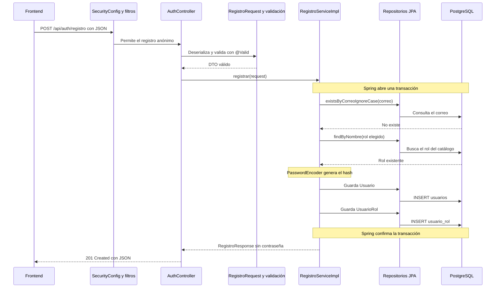

# Registro de HabitaCheck con arquitectura en capas

El endpoint `POST /api/auth/registro` crea un usuario activo y le asigna el rol que eligió: arrendatario o arrendador. El administrador existe en el catálogo, pero no se puede elegir durante el registro público. El código guarda una contraseña mediante hash y devuelve únicamente información pública.

El usuario y su asignación de rol forman una sola operación. Si falla alguno de los dos registros, la transacción revierte ambos. Registrar una cuenta no inicia sesión: el login será otro caso de uso.

## Estructura del proyecto

Todas las clases de producción están debajo de `src/main/java/com/habitacheck/backend/`, el paquete de `BackendApplication`. Esto permite que Spring encuentre controladores, servicios, configuraciones y repositorios.

```text
backend/
├── pom.xml
├── docs/
│   └── registro-capas.md
└── src/
    ├── main/
    │   ├── java/com/habitacheck/backend/
    │   │   ├── BackendApplication.java
    │   │   ├── controller/AuthController.java
    │   │   ├── dto/
    │   │   │   ├── request/RegistroRequest.java
    │   │   │   ├── request/RolRegistro.java
    │   │   │   └── response/RegistroResponse.java
    │   │   ├── service/
    │   │   │   ├── RegistroService.java
    │   │   │   └── impl/RegistroServiceImpl.java
    │   │   ├── entity/
    │   │   │   ├── Usuario.java
    │   │   │   ├── Rol.java
    │   │   │   └── UsuarioRol.java
    │   │   ├── repository/
    │   │   │   ├── UsuarioRepository.java
    │   │   │   ├── RolRepository.java
    │   │   │   └── UsuarioRolRepository.java
    │   │   ├── config/
    │   │   │   ├── PasswordConfig.java
    │   │   │   └── SecurityConfig.java
    │   │   └── exception/
    │   │       ├── CorreoYaRegistradoException.java
    │   │       └── GlobalExceptionHandler.java
    │   └── resources/
    │       ├── application.properties
    │       └── db/migration/
    │           ├── V1__crear_tablas_registro.sql
    │           └── V2__cargar_roles.sql
    └── test/java/com/habitacheck/backend/
        ├── BackendApplicationTests.java
        ├── controller/AuthControllerTest.java
        ├── service/RegistroServiceImplTest.java
        └── RegistroIntegrationTest.java
```

## Por qué separar las capas

| Capa | Responsabilidad | Dependencias en esta implementación |
|---|---|---|
| Presentación | Traducir HTTP a una operación de registro y devolver HTTP | DTO y contrato `RegistroService` |
| Servicio | Coordinar reglas de registro y la transacción | Repositorios, entidades y `PasswordEncoder` |
| Persistencia | Consultar y guardar registros | Spring Data JPA y entidades |
| Entidades | Representar los datos y relaciones persistentes | Anotaciones de JPA |

Los DTO describen la entrada y la salida de la API. Las configuraciones registran componentes y establecen la seguridad. Las excepciones representan errores y su traducción a HTTP. Estas carpetas apoyan a las capas.

El controlador nunca consulta un repositorio. Un repositorio no decide qué rol se permite en el registro. Una entidad no decide qué código HTTP devolver. Así, cada cambio tiene un lugar definido.

## Flujo al iniciar la aplicación

1. `BackendApplication` arranca Spring Boot y habilita el descubrimiento de componentes bajo `com.habitacheck.backend`.
2. La configuración de conexión lee `DB_URL`, `DB_USER` y `DB_PASSWORD`. Spring Boot no carga automáticamente un archivo `.env`: las variables deben existir en el proceso o configurarse desde el IDE.
3. Flyway aplica las migraciones pendientes. Hibernate valida que las tablas coincidan con las entidades porque `ddl-auto=validate` no crea tablas.
4. Spring Data registra las implementaciones de las interfaces de repositorio. Por eso no escribes una clase `UsuarioRepositoryImpl`.
5. `PasswordConfig` proporciona el bean `PasswordEncoder`.
6. Spring crea `RegistroServiceImpl` y le entrega los tres repositorios y el codificador a través del constructor.
7. Spring crea `AuthController` y le entrega el servicio a través de la interfaz `RegistroService`.
8. `SecurityConfig` registra la cadena de filtros que procesará las peticiones antes del controlador.

Spring gestiona estos objetos. Las entidades y los DTO se crean cuando hacen falta; no son componentes compartidos del contenedor.

## Flujo de una petición válida



`saveAndFlush` envía los cambios a la base de datos, pero no confirma la transacción. Si la segunda operación falla, también se revierte el primer `INSERT`. La confirmación ocurre cuando termina correctamente la llamada al servicio a través del proxy de Spring.

## Flujo cuando ocurre un error

| Situación | Dónde se detecta | Respuesta |
|---|---|---|
| JSON mal formado o rol fuera de las opciones | Deserialización del DTO | 400 |
| Nombre vacío, correo inválido o contraseña fuera de los límites | Bean Validation con `@Valid` | 400 con errores por campo |
| Correo ya registrado | `RegistroServiceImpl` | 409 |
| Dos peticiones intentan registrar el mismo correo | Índice único de PostgreSQL | Una crea la cuenta; la otra recibe 409 |
| Falta el rol en el catálogo o falla otra operación de persistencia | Servicio o base de datos | 500 sin detalles internos |
| Acceso anónimo a otra ruta protegida | Filtros de Spring Security | 401 para una petición GET |

`GlobalExceptionHandler` maneja las excepciones que llegan desde MVC. Los filtros de seguridad trabajan antes del controlador y sus errores se configuran en `SecurityConfig`.

El manejador solo convierte en correo duplicado la violación del índice `ux_usuarios_correo_lower`. No convierte todos los fallos de base de datos en 409, porque podrían ser errores de claves foráneas u otras restricciones.

## Ejemplo de entrada y salida

Petición:

```http
POST http://localhost:8080/api/auth/registro
Content-Type: application/json

{
  "nombre": "Ana Pérez",
  "correo": "ana@example.com",
  "password": "ClaveSegura123!",
  "telefono": "5512345678",
  "rol": "arrendador"
}
```

`telefono` es opcional. El DTO convierte teléfonos vacíos a `null`, elimina espacios exteriores de nombre y correo, y convierte el correo a minúsculas. La contraseña conserva exactamente los caracteres recibidos.

Respuesta ilustrativa con HTTP 201; el identificador y la fecha reales los genera el sistema:

```json
{
  "idUsuario": 1,
  "nombre": "Ana Pérez",
  "correo": "ana@example.com",
  "telefono": "5512345678",
  "estado": "activo",
  "roles": ["arrendador"],
  "fechaRegistro": "2026-10-11T18:00:00Z"
}
```

La respuesta usa una lista de roles porque tu modelo permite varios roles por usuario, aunque esta operación asigne solo uno inicialmente.

## SOLID aplicado a este código

### S Responsabilidad única

`AuthController` se ocupa del contrato HTTP. `RegistroServiceImpl` coordina el caso de uso. Los repositorios se ocupan de la persistencia. `PasswordEncoder` se ocupa del hash. `GlobalExceptionHandler` traduce errores a HTTP. El servicio puede coordinar varios pasos sin romper SRP: todos pertenecen a la operación de registro.

### O Abierto a extensión

El servicio recibe un `PasswordEncoder` y llama a `encode`. Puedes cambiar el bean por otro codificador compatible sin cambiar la lógica del registro. Si cambias el algoritmo, también debes revisar sus límites de entrada y la compatibilidad de los hashes anteriores; la abstracción no elimina esa responsabilidad.

### L Sustitución de Liskov

Una implementación que sustituya a `RegistroServiceImpl` debe cumplir el contrato de `RegistroService`: aceptar los datos válidos definidos por el DTO, crear usuario y asignación juntos, rechazar duplicados y devolver una respuesta pública. Una implementación que omita el rol o devuelva la contraseña rompería ese comportamiento aunque compilara. La interfaz y las pruebas ayudan a conservar el contrato; declararlo no garantiza por sí solo LSP.

### I Segregación de interfaces

`RegistroService` expone una sola operación que necesita el controlador. Cuando añadas login, puedes darle su propio contrato. El controlador no recibe una interfaz con funciones de propiedades, tickets o administración que no usa.

`JpaRepository` es una interfaz amplia proporcionada por el framework. Esta solución la usa por conveniencia dentro de persistencia. Si después necesitas contratos de persistencia más pequeños, puedes definir interfaces propias con solo las operaciones necesarias y adaptarlas a JPA.

### D Inversión de dependencias

El controlador depende del contrato `RegistroService`, no de su implementación. El servicio recibe `PasswordEncoder` y las interfaces de repositorio. No construye una conexión SQL ni un codificador concreto.

Esta es una arquitectura en capas vinculada a Spring y JPA. Los repositorios extienden `JpaRepository` y las entidades tienen anotaciones de JPA; por eso no se afirma que el negocio sea completamente independiente del framework. Para lograr esa independencia se necesitarían contratos propios de persistencia y adaptadores, si el proyecto llega a requerirlos.

## Dependency Injection explicado

Inyección de dependencias significa que una clase recibe los objetos que necesita desde fuera. Inversión de dependencias es el principio sobre qué contratos conviene utilizar. Son conceptos relacionados, pero diferentes.

En el constructor de `AuthController`, el parámetro `RegistroService` declara lo que necesita el controlador. Spring encuentra el componente `RegistroServiceImpl`, que implementa esa interfaz, y lo entrega al crear el controlador.

En el constructor de `RegistroServiceImpl`, los parámetros declaran las cuatro dependencias del servicio. Spring entrega los proxies de repositorio creados por Spring Data y el bean `PasswordEncoder` declarado en `PasswordConfig`.

Los campos son `final` porque las dependencias quedan establecidas al construir el objeto. Como cada clase tiene un único constructor, no necesita `@Autowired` en ese constructor. Si más adelante hay dos beans que implementen el mismo contrato, tendrás que seleccionar uno con `@Qualifier` o establecer un bean principal con `@Primary`.

`new Usuario(...)` y `new UsuarioRol(...)` sí son apropiados: crean los datos de esta operación. El servicio no usa `new` para construir sus repositorios o su codificador. En las pruebas unitarias se construye el servicio con `new RegistroServiceImpl(...)` y se inyectan dobles de prueba, lo cual demuestra que sus colaboradores son explícitos.

`@Transactional` funciona mediante el proxy que Spring coloca alrededor del servicio. El controlador llama al bean gestionado por Spring, por lo que se abre la transacción. Una instancia creada manualmente con `new RegistroServiceImpl(...)` no obtiene automáticamente ese comportamiento; por eso la reversión real se comprueba con una prueba de integración.

## Preparar la base y ejecutar

Las migraciones entregadas parten de una base vacía y crean solamente las tres tablas del registro. Las demás tablas del modelo se pueden introducir con migraciones posteriores.

Si las tablas ya existen, hay que comparar el esquema y la historia de migraciones antes de utilizar esta V1. No actives `baseline-on-migrate` ni reemplaces las tablas automáticamente. Si el índice de correo existente tiene otro nombre, adapta también la detección del conflicto en `GlobalExceptionHandler`.

El documento original menciona `intentos_fallidos` y `bloqueado_hasta` en el texto, pero no los incluye en el diccionario de columnas de usuarios. Esta implementación usa las columnas del diccionario. Esos campos deben acordarse cuando se implemente el bloqueo de acceso.

Configura la conexión en el proceso de PowerShell que ejecutará el backend. Usa tus credenciales locales; las de este ejemplo son marcadores:

```powershell
$env:DB_URL = 'jdbc:postgresql://localhost:5432/habitacheck'
$env:DB_USER = 'TU_USUARIO'
$env:DB_PASSWORD = 'TU_PASSWORD'
Set-Location backend
.\mvnw.cmd spring-boot:run
```

`SecurityConfig` permite únicamente el POST público de registro y mantiene las demás rutas sujetas a autenticación. El registro utiliza JSON sin sesión ni autenticación por cookies; la excepción de CSRF se limita a esa ruta y método. Al introducir login y decidir entre sesiones y tokens, revisa la configuración de seguridad junto con esa decisión.

Para las pruebas unitarias y del controlador, que no necesitan PostgreSQL:

```powershell
.\mvnw.cmd '-Dtest=AuthControllerTest,RegistroServiceImplTest' test
```

Las pruebas de integración requieren una base dedicada llamada `habitacheck_registro_test`, configurada mediante las mismas variables de conexión. El nombre se comprueba antes de limpiar los registros de prueba. Habilítalas explícitamente:

```powershell
$env:DB_URL = 'jdbc:postgresql://localhost:5432/habitacheck_registro_test'
$env:DB_USER = 'TU_USUARIO_DE_PRUEBAS'
$env:DB_PASSWORD = 'TU_PASSWORD_DE_PRUEBAS'
$env:HABITACHECK_INTEGRATION_TESTS = 'true'
.\mvnw.cmd test
```

## Fuentes oficiales

- [Inyección por constructor en Spring](https://docs.spring.io/spring-framework/reference/core/beans/annotation-config/autowired.html).
- [Contraseñas y PasswordEncoder](https://docs.spring.io/spring-security/reference/features/authentication/password-storage.html).
- [Transacciones declarativas](https://docs.spring.io/spring-framework/reference/data-access/transaction/declarative/annotations.html).
- [Consultas de Spring Data JPA](https://docs.spring.io/spring-data/jpa/reference/repositories/query-methods-details.html).
- [Inicialización y migraciones con Flyway](https://docs.spring.io/spring-boot/how-to/data-initialization.html).
- [Protección CSRF](https://docs.spring.io/spring-security/reference/servlet/exploits/csrf.html).

## Código completo y explicación de cada archivo

Los bloques siguientes reproducen los archivos del proyecto. Incluyen imports, anotaciones y métodos completos. Lombok genera los getters y el constructor protegido sin argumentos que necesita JPA, según las anotaciones de las entidades.


### 1 BackendApplication.java

Ruta: `src/main/java/com/habitacheck/backend/BackendApplication.java`

Es el punto de entrada que ya existía. @SpringBootApplication activa la configuración automática y el descubrimiento de componentes. Se ejecuta una vez al arrancar, antes de las peticiones.

```java
package com.habitacheck.backend;

import org.springframework.boot.SpringApplication;
import org.springframework.boot.autoconfigure.SpringBootApplication;

@SpringBootApplication
public class BackendApplication {

	public static void main(String[] args) {
		SpringApplication.run(BackendApplication.class, args);
	}

}
```


### 2 RolRegistro.java

Ruta: `src/main/java/com/habitacheck/backend/dto/request/RolRegistro.java`

Define las únicas dos opciones del registro público. @JsonProperty permite recibir arrendatario o arrendador en el JSON. El administrador permanece en la tabla roles, pero no en este contrato público. Se utiliza al convertir el JSON y al buscar el rol del catálogo.

```java
package com.habitacheck.backend.dto.request;

import com.fasterxml.jackson.annotation.JsonProperty;

public enum RolRegistro {
    @JsonProperty("arrendatario")
    ARRENDATARIO("arrendatario"),

    @JsonProperty("arrendador")
    ARRENDADOR("arrendador");

    private final String nombre;

    RolRegistro(String nombre) {
        this.nombre = nombre;
    }

    public String getNombre() {
        return nombre;
    }
}
```


### 3 RegistroRequest.java

Ruta: `src/main/java/com/habitacheck/backend/dto/request/RegistroRequest.java`

Define el contrato de entrada. Un record proporciona constructor y accesores como correo() y password(). Su constructor normaliza los campos no secretos; las anotaciones jakarta.validation comprueban datos obligatorios, tamaños y formato. La regla de bytes evita exceder el límite de BCrypt con caracteres Unicode. Se utiliza antes de llamar al servicio. Su toString oculta la contraseña.

```java
package com.habitacheck.backend.dto.request;

import com.fasterxml.jackson.annotation.JsonIgnore;
import jakarta.validation.constraints.AssertTrue;
import jakarta.validation.constraints.Email;
import jakarta.validation.constraints.NotBlank;
import jakarta.validation.constraints.NotNull;
import jakarta.validation.constraints.Size;
import java.nio.charset.StandardCharsets;
import java.util.Locale;

public record RegistroRequest(
        @NotBlank(message = "El nombre es obligatorio")
        @Size(max = 150, message = "El nombre admite hasta 150 caracteres")
        String nombre,

        @NotBlank(message = "El correo es obligatorio")
        @Email(message = "El correo debe ser válido")
        @Size(max = 254, message = "El correo admite hasta 254 caracteres")
        String correo,

        @NotBlank(message = "La contraseña es obligatoria")
        @Size(min = 8, max = 72, message = "La contraseña debe tener entre 8 y 72 caracteres")
        String password,

        @Size(max = 25, message = "El teléfono admite hasta 25 caracteres")
        String telefono,

        @NotNull(message = "Debes elegir arrendatario o arrendador")
        RolRegistro rol) {

    public RegistroRequest {
        nombre = nombre == null ? null : nombre.strip();
        correo = correo == null ? null : correo.strip().toLowerCase(Locale.ROOT);
        telefono = telefono == null || telefono.isBlank() ? null : telefono.strip();
    }

    // BCrypt limita la entrada a 72 bytes; un carácter puede ocupar varios bytes.
    @JsonIgnore
    @AssertTrue(message = "La contraseña admite hasta 72 bytes en UTF-8")
    public boolean isPasswordUtf8Valida() {
        return password == null || password.getBytes(StandardCharsets.UTF_8).length <= 72;
    }

    @Override
    public String toString() {
        return "RegistroRequest[password=PROTEGIDA]";
    }
}
```


### 4 RegistroResponse.java

Ruta: `src/main/java/com/habitacheck/backend/dto/response/RegistroResponse.java`

Define exactamente lo que puede salir de la API. No contiene password ni relaciones JPA. El servicio lo construye después de guardar; el controlador lo devuelve como JSON. Separarlo permite cambiar las entidades sin exponer nuevas columnas automáticamente.

```java
package com.habitacheck.backend.dto.response;

import java.time.OffsetDateTime;
import java.util.List;

public record RegistroResponse(
        Long idUsuario,
        String nombre,
        String correo,
        String telefono,
        String estado,
        List<String> roles,
        OffsetDateTime fechaRegistro) {
}
```


### 5 Usuario.java

Ruta: `src/main/java/com/habitacheck/backend/entity/Usuario.java`

Mapea usuarios. @Id identifica la PK; @GeneratedValue usa la identidad de PostgreSQL; @Column conserva nombres, longitudes y nulabilidad. El constructor recibe el hash, no la contraseña original, y fija estado activo. fotoPerfil y ultimoAcceso permanecen null inicialmente. @Getter y @NoArgsConstructor son de Lombok. Se crea en el servicio y se persiste con UsuarioRepository.

```java
package com.habitacheck.backend.entity;

import jakarta.persistence.Column;
import jakarta.persistence.Entity;
import jakarta.persistence.GeneratedValue;
import jakarta.persistence.GenerationType;
import jakarta.persistence.Id;
import jakarta.persistence.Table;
import java.time.OffsetDateTime;
import lombok.AccessLevel;
import lombok.Getter;
import lombok.NoArgsConstructor;

@Entity
@Table(name = "usuarios")
@Getter
@NoArgsConstructor(access = AccessLevel.PROTECTED)
public class Usuario {

    @Id
    @GeneratedValue(strategy = GenerationType.IDENTITY)
    @Column(name = "id_usuario")
    private Long idUsuario;

    @Column(name = "password", nullable = false, length = 255)
    private String password;

    @Column(name = "nombre", nullable = false, length = 150)
    private String nombre;

    @Column(name = "correo", nullable = false, length = 254)
    private String correo;

    @Column(name = "telefono", length = 25)
    private String telefono;

    @Column(name = "foto_perfil", columnDefinition = "TEXT")
    private String fotoPerfil;

    @Column(name = "estado", nullable = false, length = 20)
    private String estado;

    @Column(name = "fecha_registro", nullable = false)
    private OffsetDateTime fechaRegistro;

    @Column(name = "ultimo_acceso")
    private OffsetDateTime ultimoAcceso;

    public Usuario(String nombre, String correo, String password,
                   String telefono, OffsetDateTime fechaRegistro) {
        this.nombre = nombre;
        this.correo = correo;
        this.password = password;
        this.telefono = telefono;
        this.estado = "activo";
        this.fechaRegistro = fechaRegistro;
    }
}
```


### 6 Rol.java

Ruta: `src/main/java/com/habitacheck/backend/entity/Rol.java`

Mapea el catálogo roles. Cada rol existe una vez y puede asignarse a muchas personas. El registro consulta un rol ya cargado por la migración; no crea un rol por cada usuario. El constructor público también permite preparar datos en pruebas.

```java
package com.habitacheck.backend.entity;

import jakarta.persistence.Column;
import jakarta.persistence.Entity;
import jakarta.persistence.GeneratedValue;
import jakarta.persistence.GenerationType;
import jakarta.persistence.Id;
import jakarta.persistence.Table;
import lombok.AccessLevel;
import lombok.Getter;
import lombok.NoArgsConstructor;

@Entity
@Table(name = "roles")
@Getter
@NoArgsConstructor(access = AccessLevel.PROTECTED)
public class Rol {

    @Id
    @GeneratedValue(strategy = GenerationType.IDENTITY)
    @Column(name = "id_rol")
    private Long idRol;

    @Column(name = "nombre", nullable = false, length = 40)
    private String nombre;

    @Column(name = "descripcion", columnDefinition = "TEXT")
    private String descripcion;

    public Rol(String nombre, String descripcion) {
        this.nombre = nombre;
        this.descripcion = descripcion;
    }
}
```


### 7 UsuarioRol.java

Ruta: `src/main/java/com/habitacheck/backend/entity/UsuarioRol.java`

Mapea la tabla intermedia usuario_rol con su propia PK id_usuario_rol. Dos @ManyToOne representan las FK hacia usuario y rol. LAZY evita cargar relaciones cuando no se necesitan. La pareja id_usuario/id_rol es única. Se crea después del usuario y se guarda en la misma transacción. Así se conserva el modelo de varios roles por persona.

```java
package com.habitacheck.backend.entity;

import jakarta.persistence.Column;
import jakarta.persistence.Entity;
import jakarta.persistence.FetchType;
import jakarta.persistence.GeneratedValue;
import jakarta.persistence.GenerationType;
import jakarta.persistence.Id;
import jakarta.persistence.JoinColumn;
import jakarta.persistence.ManyToOne;
import jakarta.persistence.Table;
import jakarta.persistence.UniqueConstraint;
import java.time.OffsetDateTime;
import lombok.AccessLevel;
import lombok.Getter;
import lombok.NoArgsConstructor;

@Entity
@Table(name = "usuario_rol", uniqueConstraints = @UniqueConstraint(
        name = "uq_usuario_rol", columnNames = {"id_usuario", "id_rol"}))
@Getter
@NoArgsConstructor(access = AccessLevel.PROTECTED)
public class UsuarioRol {

    @Id
    @GeneratedValue(strategy = GenerationType.IDENTITY)
    @Column(name = "id_usuario_rol")
    private Long idUsuarioRol;

    @ManyToOne(fetch = FetchType.LAZY, optional = false)
    @JoinColumn(name = "id_usuario", nullable = false)
    private Usuario usuario;

    @ManyToOne(fetch = FetchType.LAZY, optional = false)
    @JoinColumn(name = "id_rol", nullable = false)
    private Rol rol;

    @Column(name = "fecha_asignacion", nullable = false)
    private OffsetDateTime fechaAsignacion;

    public UsuarioRol(Usuario usuario, Rol rol, OffsetDateTime fechaAsignacion) {
        this.usuario = usuario;
        this.rol = rol;
        this.fechaAsignacion = fechaAsignacion;
    }
}
```


### 8 UsuarioRepository.java

Ruta: `src/main/java/com/habitacheck/backend/repository/UsuarioRepository.java`

Declara operaciones de persistencia para Usuario y una PK Long. Spring Data implementa el repositorio; existsByCorreoIgnoreCase genera una consulta por correo sin distinguir mayúsculas. El servicio lo consulta y luego utiliza saveAndFlush. La consulta previa mejora el error; el índice único protege también ante concurrencia.

```java
package com.habitacheck.backend.repository;

import com.habitacheck.backend.entity.Usuario;
import org.springframework.data.jpa.repository.JpaRepository;

public interface UsuarioRepository extends JpaRepository<Usuario, Long> {
    boolean existsByCorreoIgnoreCase(String correo);
}
```


### 9 RolRepository.java

Ruta: `src/main/java/com/habitacheck/backend/repository/RolRepository.java`

Declara la búsqueda de un rol por nombre. Optional obliga al servicio a contemplar que el catálogo esté incompleto. El registro lo utiliza después de comprobar el correo y antes de crear el usuario.

```java
package com.habitacheck.backend.repository;

import com.habitacheck.backend.entity.Rol;
import java.util.Optional;
import org.springframework.data.jpa.repository.JpaRepository;

public interface RolRepository extends JpaRepository<Rol, Long> {
    Optional<Rol> findByNombre(String nombre);
}
```


### 10 UsuarioRolRepository.java

Ruta: `src/main/java/com/habitacheck/backend/repository/UsuarioRolRepository.java`

Persiste la asignación usuario/rol. No necesita consultas personalizadas para este caso de uso: saveAndFlush ya viene de JpaRepository. El servicio lo utiliza después de guardar Usuario. Si falla, la transacción revierte también el usuario.

```java
package com.habitacheck.backend.repository;

import com.habitacheck.backend.entity.UsuarioRol;
import org.springframework.data.jpa.repository.JpaRepository;

public interface UsuarioRolRepository extends JpaRepository<UsuarioRol, Long> {
}
```


### 11 RegistroService.java

Ruta: `src/main/java/com/habitacheck/backend/service/RegistroService.java`

Es el contrato del caso de uso. El controlador conoce esta interfaz en vez de la clase concreta. @NotNull y @Valid declaran el contrato de validación; @Validated en la implementación habilita la validación cuando se invoca el bean de Spring. La interfaz separa al consumidor del servicio de la implementación, aunque los DTO y repositorios siguen vinculados a esta aplicación.

```java
package com.habitacheck.backend.service;

import com.habitacheck.backend.dto.request.RegistroRequest;
import com.habitacheck.backend.dto.response.RegistroResponse;
import jakarta.validation.Valid;
import jakarta.validation.constraints.NotNull;

public interface RegistroService {
    RegistroResponse registrar(@NotNull @Valid RegistroRequest request);
}
```


### 12 RegistroServiceImpl.java

Ruta: `src/main/java/com/habitacheck/backend/service/impl/RegistroServiceImpl.java`

Implementa el registro completo. @Service registra el componente. El constructor recibe colaboradores, por lo que no crea repositorios ni codificadores. @Transactional abre la unidad de trabajo cuando el controlador llama al bean de Spring. Busca correo y rol, genera el hash, guarda Usuario y UsuarioRol y construye la respuesta. La fecha se genera en UTC. Las excepciones salen del servicio para que Spring haga rollback y MVC traduzca el error.

```java
package com.habitacheck.backend.service.impl;

import com.habitacheck.backend.dto.request.RegistroRequest;
import com.habitacheck.backend.dto.response.RegistroResponse;
import com.habitacheck.backend.entity.Rol;
import com.habitacheck.backend.entity.Usuario;
import com.habitacheck.backend.entity.UsuarioRol;
import com.habitacheck.backend.exception.CorreoYaRegistradoException;
import com.habitacheck.backend.repository.RolRepository;
import com.habitacheck.backend.repository.UsuarioRepository;
import com.habitacheck.backend.repository.UsuarioRolRepository;
import com.habitacheck.backend.service.RegistroService;
import java.time.OffsetDateTime;
import java.time.ZoneOffset;
import java.util.List;
import org.springframework.security.crypto.password.PasswordEncoder;
import org.springframework.stereotype.Service;
import org.springframework.transaction.annotation.Transactional;
import org.springframework.validation.annotation.Validated;

@Service
@Validated
public class RegistroServiceImpl implements RegistroService {

    private final UsuarioRepository usuarioRepository;
    private final RolRepository rolRepository;
    private final UsuarioRolRepository usuarioRolRepository;
    private final PasswordEncoder passwordEncoder;

    public RegistroServiceImpl(
            UsuarioRepository usuarioRepository,
            RolRepository rolRepository,
            UsuarioRolRepository usuarioRolRepository,
            PasswordEncoder passwordEncoder) {
        this.usuarioRepository = usuarioRepository;
        this.rolRepository = rolRepository;
        this.usuarioRolRepository = usuarioRolRepository;
        this.passwordEncoder = passwordEncoder;
    }

    @Override
    @Transactional
    public RegistroResponse registrar(RegistroRequest request) {
        if (usuarioRepository.existsByCorreoIgnoreCase(request.correo())) {
            throw new CorreoYaRegistradoException();
        }

        Rol rol = rolRepository.findByNombre(request.rol().getNombre())
                .orElseThrow(() -> new IllegalStateException(
                        "El rol de registro no está cargado en la base de datos"));

        OffsetDateTime fecha = OffsetDateTime.now(ZoneOffset.UTC);
        String hash = passwordEncoder.encode(request.password());

        Usuario usuario = new Usuario(
                request.nombre(), request.correo(), hash, request.telefono(), fecha);
        usuarioRepository.saveAndFlush(usuario);

        usuarioRolRepository.saveAndFlush(new UsuarioRol(usuario, rol, fecha));

        return new RegistroResponse(
                usuario.getIdUsuario(), usuario.getNombre(), usuario.getCorreo(),
                usuario.getTelefono(), usuario.getEstado(),
                List.of(rol.getNombre()), usuario.getFechaRegistro());
    }
}
```


### 13 AuthController.java

Ruta: `src/main/java/com/habitacheck/backend/controller/AuthController.java`

Es la entrada HTTP. @RequestMapping y @PostMapping forman POST /api/auth/registro. @RequestBody convierte el JSON al DTO y @Valid solicita validación antes de entrar al método. El constructor recibe RegistroService. El método llama al servicio y establece HTTP 201. No consulta SQL ni genera hashes.

```java
package com.habitacheck.backend.controller;

import com.habitacheck.backend.dto.request.RegistroRequest;
import com.habitacheck.backend.dto.response.RegistroResponse;
import com.habitacheck.backend.service.RegistroService;
import jakarta.validation.Valid;
import org.springframework.http.HttpStatus;
import org.springframework.http.ResponseEntity;
import org.springframework.web.bind.annotation.PostMapping;
import org.springframework.web.bind.annotation.RequestBody;
import org.springframework.web.bind.annotation.RequestMapping;
import org.springframework.web.bind.annotation.RestController;

@RestController
@RequestMapping("/api/auth")
public class AuthController {

    private final RegistroService registroService;

    public AuthController(RegistroService registroService) {
        this.registroService = registroService;
    }

    @PostMapping("/registro")
    public ResponseEntity<RegistroResponse> registrar(
            @Valid @RequestBody RegistroRequest request) {
        return ResponseEntity.status(HttpStatus.CREATED)
                .body(registroService.registrar(request));
    }
}
```


### 14 PasswordConfig.java

Ruta: `src/main/java/com/habitacheck/backend/config/PasswordConfig.java`

Registra un bean PasswordEncoder que Spring puede inyectar. DelegatingPasswordEncoder almacena el identificador del algoritmo junto al hash y actualmente codifica con BCrypt. Se ejecuta durante el arranque. En el registro se llama encode; en un futuro login se llamará matches. El hash es unidireccional y no se descifra.

```java
package com.habitacheck.backend.config;

import org.springframework.context.annotation.Bean;
import org.springframework.context.annotation.Configuration;
import org.springframework.security.crypto.factory.PasswordEncoderFactories;
import org.springframework.security.crypto.password.PasswordEncoder;

@Configuration
public class PasswordConfig {

    @Bean
    public PasswordEncoder passwordEncoder() {
        return PasswordEncoderFactories.createDelegatingPasswordEncoder();
    }
}
```


### 15 SecurityConfig.java

Ruta: `src/main/java/com/habitacheck/backend/config/SecurityConfig.java`

Registra SecurityFilterChain. Los filtros se ejecutan antes de MVC. Permite el POST de registro anónimo, establece una API sin sesión y mantiene otras rutas bajo autenticación. La exclusión de CSRF se limita al POST público de registro. Se deshabilitan los formularios y HTTP Basic porque aún no hay login implementado. Esta clase debe evolucionar junto con el mecanismo de autenticación elegido.

```java
package com.habitacheck.backend.config;

import org.springframework.context.annotation.Bean;
import org.springframework.context.annotation.Configuration;
import org.springframework.http.HttpMethod;
import org.springframework.http.HttpStatus;
import org.springframework.security.config.annotation.web.builders.HttpSecurity;
import org.springframework.security.config.annotation.web.configurers.AbstractHttpConfigurer;
import org.springframework.security.config.http.SessionCreationPolicy;
import org.springframework.security.web.SecurityFilterChain;
import org.springframework.security.web.authentication.HttpStatusEntryPoint;
import org.springframework.security.web.servlet.util.matcher.PathPatternRequestMatcher;

@Configuration
public class SecurityConfig {

    @Bean
    public SecurityFilterChain securityFilterChain(HttpSecurity http) throws Exception {
        var registro = PathPatternRequestMatcher.withDefaults()
                .matcher(HttpMethod.POST, "/api/auth/registro");

        return http
                // Este endpoint crea una cuenta sin usar autenticación por cookies.
                // Se conserva CSRF para las demás rutas.
                .csrf(csrf -> csrf.ignoringRequestMatchers(registro))
                .sessionManagement(session -> session
                        .sessionCreationPolicy(SessionCreationPolicy.STATELESS))
                .authorizeHttpRequests(auth -> auth
                        .requestMatchers(registro).permitAll()
                        .anyRequest().authenticated())
                .formLogin(AbstractHttpConfigurer::disable)
                .httpBasic(AbstractHttpConfigurer::disable)
                .exceptionHandling(errors -> errors.authenticationEntryPoint(
                        new HttpStatusEntryPoint(HttpStatus.UNAUTHORIZED)))
                .build();
    }
}
```


### 16 CorreoYaRegistradoException.java

Ruta: `src/main/java/com/habitacheck/backend/exception/CorreoYaRegistradoException.java`

Da un nombre específico al conflicto detectado en el servicio. Hereda de RuntimeException, por lo que provoca rollback por defecto si aparece dentro de la transacción. El servicio no necesita conocer HTTP para señalar el error.

```java
package com.habitacheck.backend.exception;

public class CorreoYaRegistradoException extends RuntimeException {

    public CorreoYaRegistradoException() {
        super("El correo ya está registrado");
    }
}
```


### 17 GlobalExceptionHandler.java

Ruta: `src/main/java/com/habitacheck/backend/exception/GlobalExceptionHandler.java`

Centraliza la traducción de excepciones mediante @RestControllerAdvice. Produce ProblemDetail para validación, JSON inválido, duplicados y fallos internos. Recorre las causas de DataIntegrityViolationException para reconocer solo el índice de correo. Registra fallos internos en el servidor y devuelve mensajes públicos sin SQL ni stack trace. Se ejecuta cuando la petición MVC falla.

```java
package com.habitacheck.backend.exception;

import jakarta.validation.ConstraintViolationException;
import java.util.LinkedHashMap;
import java.util.Map;
import org.slf4j.Logger;
import org.slf4j.LoggerFactory;
import org.springframework.dao.DataIntegrityViolationException;
import org.springframework.http.HttpStatus;
import org.springframework.http.ProblemDetail;
import org.springframework.http.converter.HttpMessageNotReadableException;
import org.springframework.web.bind.MethodArgumentNotValidException;
import org.springframework.web.bind.annotation.ExceptionHandler;
import org.springframework.web.bind.annotation.RestControllerAdvice;

@RestControllerAdvice
public class GlobalExceptionHandler {

    private static final Logger LOG = LoggerFactory.getLogger(GlobalExceptionHandler.class);

    @ExceptionHandler(CorreoYaRegistradoException.class)
    public ProblemDetail correoDuplicado(CorreoYaRegistradoException exception) {
        return ProblemDetail.forStatusAndDetail(HttpStatus.CONFLICT, exception.getMessage());
    }

    @ExceptionHandler(MethodArgumentNotValidException.class)
    public ProblemDetail datosInvalidos(MethodArgumentNotValidException exception) {
        Map<String, String> errores = new LinkedHashMap<>();
        exception.getBindingResult().getFieldErrors().forEach(error -> {
            String campo = error.getField().equals("passwordUtf8Valida")
                    ? "password" : error.getField();
            errores.putIfAbsent(campo, error.getDefaultMessage());
        });
        ProblemDetail problema = ProblemDetail.forStatusAndDetail(
                HttpStatus.BAD_REQUEST, "Revisa los datos del registro");
        problema.setProperty("errores", errores);
        return problema;
    }

    @ExceptionHandler(HttpMessageNotReadableException.class)
    public ProblemDetail jsonInvalido() {
        return ProblemDetail.forStatusAndDetail(HttpStatus.BAD_REQUEST,
                "El JSON es inválido. El rol debe ser arrendatario o arrendador");
    }

    @ExceptionHandler(ConstraintViolationException.class)
    public ProblemDetail validacionServicio() {
        return ProblemDetail.forStatusAndDetail(
                HttpStatus.BAD_REQUEST, "Revisa los datos del registro");
    }

    @ExceptionHandler(DataIntegrityViolationException.class)
    public ProblemDetail integridad(DataIntegrityViolationException exception) {
        // Solo el índice del correo equivale a un conflicto de registro.
        // Otras violaciones de integridad no deben reportarse como correo duplicado.
        for (Throwable causa = exception; causa != null; causa = causa.getCause()) {
            if (causa instanceof org.hibernate.exception.ConstraintViolationException constraint
                    && "ux_usuarios_correo_lower".equals(constraint.getConstraintName())) {
                return ProblemDetail.forStatusAndDetail(
                        HttpStatus.CONFLICT, "El correo ya está registrado");
            }
        }
        return errorInterno(exception);
    }

    @ExceptionHandler(Exception.class)
    public ProblemDetail errorInterno(Exception exception) {
        LOG.error("No se pudo completar la operación", exception);
        return ProblemDetail.forStatusAndDetail(HttpStatus.INTERNAL_SERVER_ERROR,
                "No se pudo completar la operación. Inténtalo más tarde");
    }
}
```


### 18 V1__crear_tablas_registro.sql

Ruta: `src/main/resources/db/migration/V1__crear_tablas_registro.sql`

Crea usuarios, roles y usuario_rol en una base vacía. Define identidades, FK, estados permitidos, el índice único de lower(correo) y la pareja única usuario/rol. Flyway la aplica una sola vez y guarda su versión. Si las tablas ya existen, primero hay que adaptar la estrategia de migración al esquema existente.

```sql
CREATE TABLE usuarios (
    id_usuario BIGINT GENERATED BY DEFAULT AS IDENTITY PRIMARY KEY,
    password VARCHAR(255) NOT NULL,
    nombre VARCHAR(150) NOT NULL,
    correo VARCHAR(254) NOT NULL,
    telefono VARCHAR(25),
    foto_perfil TEXT,
    estado VARCHAR(20) NOT NULL CHECK (estado IN ('activo', 'suspendido', 'eliminado')),
    fecha_registro TIMESTAMPTZ NOT NULL,
    ultimo_acceso TIMESTAMPTZ,
    CONSTRAINT ck_usuarios_correo_sin_espacios CHECK (correo = btrim(correo))
);

CREATE UNIQUE INDEX ux_usuarios_correo_lower ON usuarios (lower(correo));

CREATE TABLE roles (
    id_rol BIGINT GENERATED BY DEFAULT AS IDENTITY PRIMARY KEY,
    nombre VARCHAR(40) NOT NULL UNIQUE
        CHECK (nombre IN ('arrendatario', 'arrendador', 'administrador')),
    descripcion TEXT
);

CREATE TABLE usuario_rol (
    id_usuario_rol BIGINT GENERATED BY DEFAULT AS IDENTITY PRIMARY KEY,
    id_usuario BIGINT NOT NULL REFERENCES usuarios (id_usuario),
    id_rol BIGINT NOT NULL REFERENCES roles (id_rol),
    fecha_asignacion TIMESTAMPTZ NOT NULL,
    CONSTRAINT uq_usuario_rol UNIQUE (id_usuario, id_rol)
);
```


### 19 V2__cargar_roles.sql

Ruta: `src/main/resources/db/migration/V2__cargar_roles.sql`

Carga las tres entradas del catálogo. Esto permite que el servicio encuentre el rol elegido. Cargar administrador no crea una cuenta administradora ni permite elegirlo en la API pública. Flyway la aplica después de V1.

```sql
INSERT INTO roles (nombre, descripcion) VALUES
    ('arrendatario', 'Consulta publicaciones de propiedades'),
    ('arrendador', 'Publica y gestiona sus propias propiedades'),
    ('administrador', 'Administra usuarios y sus asignaciones de roles');
```


### 20 pom.xml

Ruta: `pom.xml`

Configura dependencias y compilación. Se conservan las dependencias originales de JPA, Security, Validation, Web MVC, PostgreSQL, Lombok y pruebas. Se añaden spring-boot-starter-flyway y flyway-database-postgresql para que las migraciones declaradas en application.properties se ejecuten realmente. Maven lo utiliza al compilar, probar y ejecutar.

```xml
<?xml version="1.0" encoding="UTF-8"?>
<project xmlns="http://maven.apache.org/POM/4.0.0" xmlns:xsi="http://www.w3.org/2001/XMLSchema-instance"
	xsi:schemaLocation="http://maven.apache.org/POM/4.0.0 https://maven.apache.org/xsd/maven-4.0.0.xsd">
	<modelVersion>4.0.0</modelVersion>
	<parent>
		<groupId>org.springframework.boot</groupId>
		<artifactId>spring-boot-starter-parent</artifactId>
		<version>4.1.1</version>
		<relativePath/> <!-- lookup parent from repository -->
	</parent>
	<groupId>com.habitacheck</groupId>
	<artifactId>backend</artifactId>
	<version>0.0.1-SNAPSHOT</version>
	<name/>
	<description/>
	<url/>
	<licenses>
		<license/>
	</licenses>
	<developers>
		<developer/>
	</developers>
	<scm>
		<connection/>
		<developerConnection/>
		<tag/>
		<url/>
	</scm>
	<properties>
		<java.version>17</java.version>
	</properties>
	<dependencies>
		<dependency>
			<groupId>org.springframework.boot</groupId>
			<artifactId>spring-boot-starter-data-jpa</artifactId>
		</dependency>
		<dependency>
			<groupId>org.springframework.boot</groupId>
			<artifactId>spring-boot-starter-security</artifactId>
		</dependency>
		<dependency>
			<groupId>org.springframework.boot</groupId>
			<artifactId>spring-boot-starter-validation</artifactId>
		</dependency>
		<dependency>
			<groupId>org.springframework.boot</groupId>
			<artifactId>spring-boot-starter-webmvc</artifactId>
		</dependency>

		<dependency>
			<groupId>org.postgresql</groupId>
			<artifactId>postgresql</artifactId>
			<scope>runtime</scope>
		</dependency>
		<dependency>
			<groupId>org.springframework.boot</groupId>
			<artifactId>spring-boot-starter-flyway</artifactId>
		</dependency>
		<dependency>
			<groupId>org.flywaydb</groupId>
			<artifactId>flyway-database-postgresql</artifactId>
		</dependency>
		<dependency>
			<groupId>org.projectlombok</groupId>
			<artifactId>lombok</artifactId>
			<optional>true</optional>
		</dependency>
		<dependency>
			<groupId>org.springframework.boot</groupId>
			<artifactId>spring-boot-starter-data-jpa-test</artifactId>
			<scope>test</scope>
		</dependency>
		<dependency>
			<groupId>org.springframework.boot</groupId>
			<artifactId>spring-boot-starter-security-test</artifactId>
			<scope>test</scope>
		</dependency>
		<dependency>
			<groupId>org.springframework.boot</groupId>
			<artifactId>spring-boot-starter-validation-test</artifactId>
			<scope>test</scope>
		</dependency>
		<dependency>
			<groupId>org.springframework.boot</groupId>
			<artifactId>spring-boot-starter-webmvc-test</artifactId>
			<scope>test</scope>
		</dependency>
	</dependencies>

	<build>
		<plugins>
			<plugin>
				<groupId>org.springframework.boot</groupId>
				<artifactId>spring-boot-maven-plugin</artifactId>
			</plugin>
			<plugin>
				<groupId>org.apache.maven.plugins</groupId>
				<artifactId>maven-compiler-plugin</artifactId>
				<executions>
					<execution>
						<id>default-compile</id>
						<phase>compile</phase>
						<goals>
							<goal>compile</goal>
						</goals>
						<configuration>
							<annotationProcessorPaths>
								<path>
									<groupId>org.projectlombok</groupId>
									<artifactId>lombok</artifactId>
								</path>
							</annotationProcessorPaths>
						</configuration>
					</execution>
					<execution>
						<id>default-testCompile</id>
						<phase>test-compile</phase>
						<goals>
							<goal>testCompile</goal>
						</goals>
						<configuration>
							<annotationProcessorPaths>
								<path>
									<groupId>org.projectlombok</groupId>
									<artifactId>lombok</artifactId>
								</path>
							</annotationProcessorPaths>
						</configuration>
					</execution>
				</executions>
			</plugin>
		</plugins>
	</build>

</project>
```


### 21 application.properties

Ruta: `src/main/resources/application.properties`

Este archivo existente define puerto y conexión mediante variables de entorno. ddl-auto=validate solicita comprobar el esquema. open-in-view=false mantiene el trabajo de persistencia dentro del servicio. spring.flyway.enabled=true activa las migraciones cuando sus dependencias están presentes. No incluye credenciales literales.

```properties
spring.application.name=backend
server.port=8080

spring.datasource.url=${DB_URL}
spring.datasource.username=${DB_USER}
spring.datasource.password=${DB_PASSWORD}

spring.datasource.driver-class-name=org.postgresql.Driver

spring.jpa.hibernate.ddl-auto=validate
spring.jpa.open-in-view=false

spring.flyway.enabled=true
```


### 22 RegistroServiceImplTest.java

Ruta: `src/test/java/com/habitacheck/backend/service/RegistroServiceImplTest.java`

Prueba ambos roles, hash, normalización, duplicados, catálogo incompleto y propagación del fallo de asignación. Construye el servicio con colaboradores simulados para probar reglas sin arrancar Spring ni PostgreSQL. No demuestra rollback real, ya que una instancia construida manualmente no tiene el proxy transaccional.

```java
package com.habitacheck.backend.service;

import com.habitacheck.backend.dto.request.RegistroRequest;
import com.habitacheck.backend.dto.request.RolRegistro;
import com.habitacheck.backend.entity.Rol;
import com.habitacheck.backend.entity.Usuario;
import com.habitacheck.backend.entity.UsuarioRol;
import com.habitacheck.backend.exception.CorreoYaRegistradoException;
import com.habitacheck.backend.repository.RolRepository;
import com.habitacheck.backend.repository.UsuarioRepository;
import com.habitacheck.backend.repository.UsuarioRolRepository;
import com.habitacheck.backend.service.impl.RegistroServiceImpl;
import java.util.Optional;
import org.junit.jupiter.api.BeforeEach;
import org.junit.jupiter.api.Test;
import org.junit.jupiter.api.extension.ExtendWith;
import org.junit.jupiter.params.ParameterizedTest;
import org.junit.jupiter.params.provider.EnumSource;
import org.mockito.ArgumentCaptor;
import org.mockito.Mock;
import org.mockito.junit.jupiter.MockitoExtension;
import org.springframework.dao.DataIntegrityViolationException;
import org.springframework.security.crypto.password.PasswordEncoder;

import static org.junit.jupiter.api.Assertions.*;
import static org.mockito.ArgumentMatchers.any;
import static org.mockito.Mockito.*;

@ExtendWith(MockitoExtension.class)
class RegistroServiceImplTest {

    @Mock UsuarioRepository usuarios;
    @Mock RolRepository roles;
    @Mock UsuarioRolRepository asignaciones;
    @Mock PasswordEncoder encoder;
    private RegistroService service;

    @BeforeEach
    void preparar() {
        service = new RegistroServiceImpl(usuarios, roles, asignaciones, encoder);
    }

    @ParameterizedTest
    @EnumSource(RolRegistro.class)
    void guardaHashYAsignaElRolElegido(RolRegistro elegido) {
        var request = new RegistroRequest(" Ana ", " ANA@EXAMPLE.COM ",
                "ClaveSegura123!", " 5512345678 ", elegido);
        Rol rol = new Rol(elegido.getNombre(), "Rol de prueba");
        when(roles.findByNombre(elegido.getNombre())).thenReturn(Optional.of(rol));
        when(encoder.encode(request.password())).thenReturn("{bcrypt}hash-de-prueba");

        var respuesta = service.registrar(request);

        var usuario = ArgumentCaptor.forClass(Usuario.class);
        verify(usuarios).saveAndFlush(usuario.capture());
        assertEquals("{bcrypt}hash-de-prueba", usuario.getValue().getPassword());
        assertEquals("ana@example.com", usuario.getValue().getCorreo());
        assertEquals("Ana", respuesta.nombre());
        assertEquals("activo", respuesta.estado());
        assertEquals(elegido.getNombre(), respuesta.roles().get(0));

        var asignacion = ArgumentCaptor.forClass(UsuarioRol.class);
        verify(asignaciones).saveAndFlush(asignacion.capture());
        assertSame(usuario.getValue(), asignacion.getValue().getUsuario());
        assertSame(rol, asignacion.getValue().getRol());
    }

    @Test
    void rechazaCorreoDuplicadoAntesDeGuardar() {
        var request = request();
        when(usuarios.existsByCorreoIgnoreCase(request.correo())).thenReturn(true);

        assertThrows(CorreoYaRegistradoException.class, () -> service.registrar(request));

        verify(usuarios, never()).saveAndFlush(any());
        verifyNoInteractions(roles, asignaciones, encoder);
    }

    @Test
    void noGuardaSiFaltaElRolEnElCatalogo() {
        when(roles.findByNombre("arrendatario")).thenReturn(Optional.empty());

        assertThrows(IllegalStateException.class, () -> service.registrar(request()));

        verify(usuarios, never()).saveAndFlush(any());
        verifyNoInteractions(asignaciones, encoder);
    }

    @Test
    void propagaElFalloDeAsignacionParaQueSpringDeshagaLaTransaccion() {
        when(roles.findByNombre("arrendatario"))
                .thenReturn(Optional.of(new Rol("arrendatario", "Prueba")));
        when(encoder.encode(any())).thenReturn("hash");
        when(asignaciones.saveAndFlush(any()))
                .thenThrow(new DataIntegrityViolationException("Fallo simulado"));

        assertThrows(DataIntegrityViolationException.class, () -> service.registrar(request()));
    }

    private RegistroRequest request() {
        return new RegistroRequest("Ana", "ana@example.com", "ClaveSegura123!",
                null, RolRegistro.ARRENDATARIO);
    }
}
```


### 23 AuthControllerTest.java

Ruta: `src/test/java/com/habitacheck/backend/controller/AuthControllerTest.java`

Prueba el contrato HTTP y la seguridad de entrada con MockMvc, un servicio simulado y la configuración real de filtros. Verifica 201 sin contraseña, validación, roles no permitidos, límite UTF-8, correo duplicado, JSON inválido y una ruta protegida. No requiere base de datos.

```java
package com.habitacheck.backend.controller;

import com.habitacheck.backend.config.SecurityConfig;
import com.habitacheck.backend.dto.response.RegistroResponse;
import com.habitacheck.backend.exception.CorreoYaRegistradoException;
import com.habitacheck.backend.exception.GlobalExceptionHandler;
import com.habitacheck.backend.service.RegistroService;
import java.time.OffsetDateTime;
import java.util.List;
import org.junit.jupiter.api.Test;
import org.junit.jupiter.params.ParameterizedTest;
import org.junit.jupiter.params.provider.ValueSource;
import org.springframework.beans.factory.annotation.Autowired;
import org.springframework.boot.webmvc.test.autoconfigure.WebMvcTest;
import org.springframework.context.annotation.Import;
import org.springframework.http.MediaType;
import org.springframework.test.context.bean.override.mockito.MockitoBean;
import org.springframework.test.web.servlet.MockMvc;

import static org.mockito.ArgumentMatchers.any;
import static org.mockito.Mockito.*;
import static org.springframework.test.web.servlet.request.MockMvcRequestBuilders.*;
import static org.springframework.test.web.servlet.result.MockMvcResultMatchers.*;

@WebMvcTest(AuthController.class)
@Import({SecurityConfig.class, GlobalExceptionHandler.class})
class AuthControllerTest {

    @Autowired MockMvc mvc;
    @MockitoBean RegistroService service;

    @Test
    void registroPublicoDevuelve201SinPassword() throws Exception {
        when(service.registrar(any())).thenReturn(new RegistroResponse(
                1L, "Ana", "ana@example.com", null, "activo",
                List.of("arrendatario"), OffsetDateTime.now()));

        mvc.perform(post("/api/auth/registro").contentType(MediaType.APPLICATION_JSON)
                        .content(body("ana@example.com", "ClaveSegura123!", "arrendatario")))
                .andExpect(status().isCreated())
                .andExpect(jsonPath("$.idUsuario").value(1))
                .andExpect(jsonPath("$.password").doesNotExist());
    }

    @Test
    void correoInvalidoDevuelve400SinLlamarAlServicio() throws Exception {
        mvc.perform(post("/api/auth/registro").contentType(MediaType.APPLICATION_JSON)
                        .content(body("correo-invalido", "ClaveSegura123!", "arrendatario")))
                .andExpect(status().isBadRequest())
                .andExpect(jsonPath("$.errores.correo").exists());
        verifyNoInteractions(service);
    }

    @ParameterizedTest
    @ValueSource(strings = {"administrador", "proveedor"})
    void rechazaRolesNoPermitidos(String rol) throws Exception {
        mvc.perform(post("/api/auth/registro").contentType(MediaType.APPLICATION_JSON)
                        .content(body("ana@example.com", "ClaveSegura123!", rol)))
                .andExpect(status().isBadRequest());
        verifyNoInteractions(service);
    }

    @Test
    void passwordUnicodeNoSuperaElLimiteDeBytesDeBcrypt() throws Exception {
        mvc.perform(post("/api/auth/registro").contentType(MediaType.APPLICATION_JSON)
                        .content(body("ana@example.com", "ñ".repeat(40), "arrendatario")))
                .andExpect(status().isBadRequest())
                .andExpect(jsonPath("$.errores.password").exists());
        verifyNoInteractions(service);
    }

    @Test
    void correoDuplicadoDevuelve409() throws Exception {
        when(service.registrar(any())).thenThrow(new CorreoYaRegistradoException());
        mvc.perform(post("/api/auth/registro").contentType(MediaType.APPLICATION_JSON)
                        .content(body("ana@example.com", "ClaveSegura123!", "arrendatario")))
                .andExpect(status().isConflict());
    }

    @Test
    void otrasRutasRequierenAutenticacion() throws Exception {
        mvc.perform(get("/api/usuarios")).andExpect(status().isUnauthorized());
    }

    @Test
    void jsonMalFormadoDevuelve400() throws Exception {
        mvc.perform(post("/api/auth/registro").contentType(MediaType.APPLICATION_JSON)
                        .content("{correo:"))
                .andExpect(status().isBadRequest());
        verifyNoInteractions(service);
    }

    private String body(String correo, String password, String rol) {
        return """
                {"nombre":"Ana","correo":"%s","password":"%s","rol":"%s"}
                """.formatted(correo, password, rol);
    }
}
```


### 24 RegistroIntegrationTest.java

Ruta: `src/test/java/com/habitacheck/backend/RegistroIntegrationTest.java`

Comprueba el flujo completo con Spring y PostgreSQL: hash verificable, FK y rol correcto, correo duplicado, rollback real y dos registros concurrentes. Solo se habilita con HABITACHECK_INTEGRATION_TESTS=true y exige que current_database() sea habitacheck_registro_test. Limpia únicamente el correo de prueba en esa base.

```java
package com.habitacheck.backend;

import com.habitacheck.backend.repository.UsuarioRolRepository;
import java.util.List;
import java.util.concurrent.CountDownLatch;
import java.util.concurrent.Executors;
import java.util.concurrent.TimeUnit;
import org.junit.jupiter.api.AfterEach;
import org.junit.jupiter.api.BeforeEach;
import org.junit.jupiter.api.Test;
import org.junit.jupiter.api.condition.EnabledIfEnvironmentVariable;
import org.junit.jupiter.params.ParameterizedTest;
import org.junit.jupiter.params.provider.ValueSource;
import org.springframework.beans.factory.annotation.Autowired;
import org.springframework.boot.test.context.SpringBootTest;
import org.springframework.boot.webmvc.test.autoconfigure.AutoConfigureMockMvc;
import org.springframework.dao.DataIntegrityViolationException;
import org.springframework.http.MediaType;
import org.springframework.jdbc.core.JdbcTemplate;
import org.springframework.security.crypto.password.PasswordEncoder;
import org.springframework.test.context.bean.override.mockito.MockitoSpyBean;
import org.springframework.test.web.servlet.MockMvc;

import static org.junit.jupiter.api.Assertions.*;
import static org.mockito.ArgumentMatchers.any;
import static org.mockito.Mockito.doThrow;
import static org.springframework.test.web.servlet.request.MockMvcRequestBuilders.post;
import static org.springframework.test.web.servlet.result.MockMvcResultMatchers.*;

@SpringBootTest
@AutoConfigureMockMvc
@EnabledIfEnvironmentVariable(named = "HABITACHECK_INTEGRATION_TESTS", matches = "true")
class RegistroIntegrationTest {

    private static final String CORREO = "registro.qa@example.com";

    @Autowired MockMvc mvc;
    @Autowired JdbcTemplate jdbc;
    @Autowired PasswordEncoder encoder;
    @MockitoSpyBean UsuarioRolRepository asignaciones;

    @BeforeEach
    void comprobarBaseAislada() {
        assertEquals("habitacheck_registro_test",
                jdbc.queryForObject("SELECT current_database()", String.class),
                "Estas pruebas solo se ejecutan en habitacheck_registro_test");
        limpiar();
    }

    @AfterEach
    void limpiar() {
        // No ejecutar limpieza si la configuración apunta a otra base de datos.
        if (!"habitacheck_registro_test".equals(
                jdbc.queryForObject("SELECT current_database()", String.class))) {
            return;
        }
        jdbc.update("DELETE FROM usuario_rol WHERE id_usuario IN "
                + "(SELECT id_usuario FROM usuarios WHERE lower(correo) = ?)", CORREO);
        jdbc.update("DELETE FROM usuarios WHERE lower(correo) = ?", CORREO);
    }

    @ParameterizedTest
    @ValueSource(strings = {"arrendatario", "arrendador"})
    void registraUsuarioConHashYRelacionReal(String rol) throws Exception {
        mvc.perform(post("/api/auth/registro").contentType(MediaType.APPLICATION_JSON)
                        .content(body(CORREO, rol)))
                .andExpect(status().isCreated())
                .andExpect(jsonPath("$.roles[0]").value(rol))
                .andExpect(jsonPath("$.password").doesNotExist());

        String hash = jdbc.queryForObject("SELECT password FROM usuarios WHERE correo = ?",
                String.class, CORREO);
        assertNotEquals("ClaveSegura123!", hash);
        assertTrue(encoder.matches("ClaveSegura123!", hash));
        assertEquals(rol, jdbc.queryForObject("""
                SELECT r.nombre FROM usuario_rol ur
                JOIN roles r ON r.id_rol = ur.id_rol
                JOIN usuarios u ON u.id_usuario = ur.id_usuario
                WHERE u.correo = ?
                """, String.class, CORREO));
    }

    @Test
    void correoDuplicadoIgnoraMayusculasYEspacios() throws Exception {
        mvc.perform(post("/api/auth/registro").contentType(MediaType.APPLICATION_JSON)
                        .content(body(CORREO, "arrendatario")))
                .andExpect(status().isCreated());
        mvc.perform(post("/api/auth/registro").contentType(MediaType.APPLICATION_JSON)
                        .content(body(" REGISTRO.QA@EXAMPLE.COM ", "arrendador")))
                .andExpect(status().isConflict());
        assertEquals(1L, cantidadUsuarios());
    }

    @Test
    void fallaAsignacionYSeDeshaceElUsuarioReal() throws Exception {
        doThrow(new DataIntegrityViolationException("Fallo simulado de la asignación"))
                .when(asignaciones).saveAndFlush(any());

        mvc.perform(post("/api/auth/registro").contentType(MediaType.APPLICATION_JSON)
                        .content(body(CORREO, "arrendatario")))
                .andExpect(status().isInternalServerError());

        assertEquals(0L, cantidadUsuarios());
    }

    @Test
    void dosSolicitudesConcurrentesCreanSoloUnUsuario() throws Exception {
        var executor = Executors.newFixedThreadPool(2);
        var inicio = new CountDownLatch(1);
        try {
            var primera = executor.submit(() -> enviarAlIniciar(inicio));
            var segunda = executor.submit(() -> enviarAlIniciar(inicio));
            inicio.countDown();
            var estados = List.of(primera.get(30, TimeUnit.SECONDS),
                    segunda.get(30, TimeUnit.SECONDS)).stream().sorted().toList();
            assertEquals(List.of(201, 409), estados);
            assertEquals(1L, cantidadUsuarios());
        } finally {
            executor.shutdownNow();
        }
    }

    private int enviarAlIniciar(CountDownLatch inicio) throws Exception {
        assertTrue(inicio.await(10, TimeUnit.SECONDS));
        return mvc.perform(post("/api/auth/registro").contentType(MediaType.APPLICATION_JSON)
                        .content(body(CORREO, "arrendatario")))
                .andReturn().getResponse().getStatus();
    }

    private long cantidadUsuarios() {
        return jdbc.queryForObject("SELECT count(*) FROM usuarios WHERE lower(correo) = ?",
                Long.class, CORREO);
    }

    private String body(String correo, String rol) {
        return """
                {"nombre":"Ana","correo":"%s","password":"ClaveSegura123!","rol":"%s"}
                """.formatted(correo, rol);
    }
}
```
